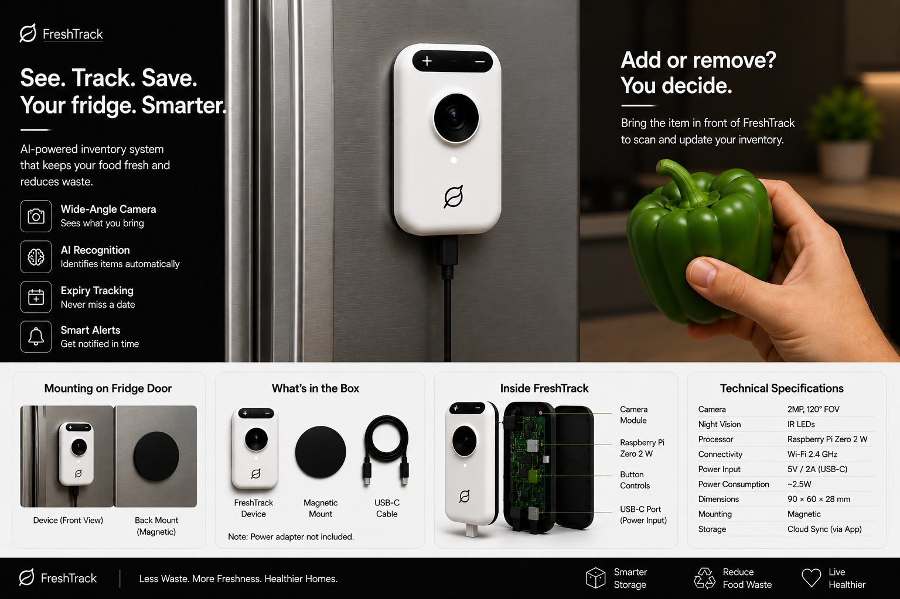

# FreshTrack (फ़्रेशट्रैक)

<p align="center">
  <strong>Next-Generation Perishable Inventory Intelligence & Zero-Waste Operating System</strong><br>
  <em>Built for Indian Households </em>
</p>

<p align="center">
  <a href="https://fresh-track.in">
    
  </a>
  <a href="https://fresh-track.in/scan-my-model">
    
  </a>
  
</p>

<p align="center">
  
  
  
  
  
  
</p>

---

## Project Summary

In India, household food waste exceeds **68 million tonnes ($6.8 \times 10^{10}$ kg) every year** (UNEP Food Waste Index). Perishable groceries—vegetables, fruits, dairy, and cooked meals—are routinely forgotten at the bottom of refrigerator drawers and pantry shelves until they spoil. Meanwhile, commercial kitchens struggle with paper-based tracking, causing inventory losses and risking **FSSAI (Food Safety and Standards Authority of India)** violations.

Standard grocery apps fail because manual data entry is tedious, produce lacks printed barcodes, and static checklists don't help you cook what you already have.

**FreshTrack** is an end-to-end perishable inventory operating system. Built with **client-side Edge AI, multi-tiered LLMs, continuous batch scanning, and dynamic climate-aware shelf life algorithms**, FreshTrack tracks what you have, predicts when it expires, and turns on-hand ingredients into meals before they spoil.

---

##  System Architecture & Workflow

```text
                             ADD GROCERIES
                                   │
      ┌──────────────┬─────────────┼─────────────┬──────────────┐
      ▼              ▼             ▼             ▼              ▼
 Custom Edge ML   Continuous     Receipt       Manual      Next-Gen IoT
 Camera Vision    Batch Barcode    OCR       Quick-Add     Fridge Unit
 (TensorFlow.js)  (+ Audio/Haptic) (Bills)  (220+ Catalog)  (Camera)
      │              │             │             │              │
      └──────────────┴─────────────┼─────────────┴──────────────┘
                                   ▼
                      INVENTORY & STORAGE ENGINE
                (Pantry ↔ Refrigerator ↔ Deep Freezer)
                                   │
      ┌────────────────────────────┼────────────────────────────┐
      ▼                            ▼                            ▼
 Dynamic Expiry              Duplicate Merge            Pantry Health Score
 & Storage Transfer          & FIFO Tracking            & Waste Analytics (₹)
      │                            │                            │
      └────────────────────────────┼────────────────────────────┘
                                   ▼
                            AI INTELLIGENCE
      ┌────────────────────────────┼────────────────────────────┐
      ▼                            ▼                            ▼
Strict Zero-Waste           Conversational               Auto-Generated
AI Recipes (Groq)           Pantry Assistant             Shopping List
```

---

##  Complete Feature Matrix

### 1. Multi-Modal Intake Engine (Add Anything in Seconds)
* **Custom On-Device Produce Freshness ML**: Point your camera at fresh produce to classify freshness and spoilage locally in real-time. Powered by a custom TensorFlow.js model running client-side with zero cloud latency and complete user privacy.
* **Continuous Batch Barcode Scanner**: High-velocity scanning mode equipped with **Web Audio chimes and haptic vibration feedback**. Scan multiple packaged items across crates or grocery bags without tapping a button between scans.
* **Self-Learning Barcode Network**: Instant sub-100ms lookup against a local database, automatic fallback to Open Food Facts, and an automatic submission queue for uncataloged Indian FMCG barcodes.
* **Receipt & Invoice OCR**: Snap a photo of a supermarket or wholesale receipt; automated OCR parses item names, dates, and prices (₹) in a single pass.
* **220+ Curated Indian Produce & Staple Catalog**: Instant bilingual search in English and Hindi (e.g., *Atta, Paneer, Methi, Curry Leaves, Ghee, Arhar Dal*) with pre-calibrated baseline shelf lives.

---

### 2. Smart Expiry & Dynamic Storage Engine
* **Zone-Aware Shelf Life Recalculation**: Expiry dates adapt dynamically based on where an item is placed:
  * **Pantry (18°C – 32°C)**: Baseline room-temperature storage.
  * **Refrigerator (2°C – 4°C)**: Extends lifespan for dairy, fresh greens, and leftovers.
  * **Deep Freezer (-18°C)**: Long-term preservation with food-specific rules (preserves staples, while preventing unrealistic extensions for delicate salad greens).
* **Storage Location Shifting**: Move an item from Pantry to Fridge with one tap; the system recalculates remaining days on the fly.
* **Automatic Duplicate Merging**: Adding an item already present in your pantry prompts smart quantity merging rather than cluttering your inventory.
* **Web Push Notifications**: Real-time browser push notifications alert you at critical 48-hour and 24-hour expiration windows.

---

### 3. Grounded Zero-Waste AI Recipes
* **Strict Pantry Grounding**: Powered by ultra-fast **Groq LLaMA-3.3-70B**. The AI is strictly barred from hallucinating missing ingredients — recipes are created exclusively from what is currently in your inventory, prioritizing items expiring first.
* **Photo-Free Editorial UI**: Clean typography and deconstructed ingredient strips that show prep time, cooking method, and pantry match rate.
* **Portion Scaling & Personal Notes**: Switch serving sizes between **1x, 2x, and 4x** with automatic ingredient math, and save personal chef notes on any recipe.
* **IST-Cached "Tonight's Recommendation"**: Automatically generates a single personalized daily dinner recommendation cached per calendar day (IST) to eliminate repetitive AI credit usage.
* **Deterministic Offline Fallbacks**: When internet connectivity drops, local heuristic templates generate authentic Indian dishes (*Tadka Dal, Vegetable Khichdi, Jeera Aloo, Stir-Fry*) without failing.

---

### 4. Financial Waste Analytics & Health Metrics
* **Pantry Health Score (0–100)**: A live health index that assesses inventory freshness ratios and rewards timely consumption.
* **Rupee-Level Financial Waste Auditing**: Quantifies the monetary value (₹) of consumed food versus spoiled items to reveal monthly savings.
* **Category & Storage Visualizations**: Clean breakdowns across Vegetables, Dairy, Bakery, Grains, and Spices, paired with storage zone distribution.
* **One-Click CSV Data Export**: Download your full inventory records—including purchase dates, expiry milestones, quantities, and cost—for external budgeting or audits.

---

### 5. Conversational Pantry Assistant & Smart Shopping
* **Context-Aware AI Assistant**: Natural language queries grounded in your live inventory:
  * *"What should I cook tonight?"*
  * *"What items are expiring in the next 48 hours?"*
  * *"Do I have enough tomatoes for a curry?"*
  * *"What staples do I need to restock?"*
* **Smart Shopping List**: Items that run out or reach zero quantity can be moved directly to your shopping list with a single tap.

---

### 6. Enterprise Security & Examiner Sandbox Gate
* **Evaluator Sandbox Gate**: Built for CBSE examiners. Enter passcode (Ask the team!) on the login screen to access a fully pre-seeded Indian kitchen demonstration without creating an account.
* **PostgreSQL Row-Level Security (RLS)**: Cryptographic multi-tenant isolation ensures no user can view or alter another user's inventory.
* **Admin Triage & In-App Support**:
  * Barcode review queue for newly registered FMCG products.
  * In-app support ticketing system where users can submit feedback and administrators can resolve tickets directly.

---

## Self-Made ML Model For The Project

FreshTrack features an independently-trained computer vision model built as an academic capstone showcase:

* **Interactive Showcase**: [`https://fresh-track.in/scan-my-model`](https://fresh-track.in/scan-my-model)
* **Architecture**: Custom lightweight Convolutional Neural Network (CNN) trained on labeled datasets of fresh and spoiled produce.
* **Edge Inference via TensorFlow.js**: Quantized and converted to run entirely in the browser using WebGL and WASM acceleration.
* **Zero Cloud Latency & Zero Cost**: Images never leave the device. Inference runs in under 40 milliseconds on mobile browsers.
* **Academic Evaluation**: Includes confusion matrices, precision/recall curves, and an integrated CBSE Technical Explainer PDF directly within the app.

---

##  What's Next: Physical Device & Commercial FSSAI Platform

### 1. The FreshTrack Fridge IoT Device
The long-term hardware vision for FreshTrack extends beyond a smartphone app to a dedicated, low-power camera unit which sticks on the refrigerator door using magnets.

<p align="center">
  
</p>

* **Automated Visual Tracking**: Wide-angle interior cameras capture items being put in/taken out of the refrigerator by touching the (+) or (-) buttons
* **Autonomous Shelf Auditing**: Edge vision models identify new, depleted, or aging items without requiring manual scanning and automatically updates the FreshTrack account inventory.

---

### 2. Commercial Cloud Kitchens & FSSAI Compliance Engine (v2.0 Roadmap)

While **v1.0 is engineered for home kitchens**, the core inventory engine is architected to scale into **commercial cloud kitchens, QSR chains, and dark stores**:

```text
┌─────────────────────────────────────────┐     ┌─────────────────────────────────────────┐
│          v1.0 (CURRENT STAGE)           │     │          v2.0 (FUTURE ROADMAP)          │
│           Smart Home Pantries           │ ──► │     Commercial Kitchens & Dark Stores   │
│       Personal Household Savings        │     │     FSSAI Digital Compliance Portal     │
└─────────────────────────────────────────┘     └─────────────────────────────────────────┘
```

#### The Commercial Challenge in India
High-volume cloud kitchens and restaurants handle large quantities of perishable ingredients daily. Kitchen staff frequently make mistakes with **FIFO (First-In, First-Out)** rotation, risking food poisoning outbreaks, heavy inventory write-offs, and violations of **FSSAI (Food Safety and Standards Authority of India)** regulations. Most commercial kitchens still track batches using error-prone paper registers.

#### Planned Enterprise Modules:
1. **FSSAI Digital Inspection Portal**:
   * A digital inspection dashboard allowing food safety inspectors to verify supplier batch certificates, cold-chain temperature logs, and expiry milestones.
   * Automated compliance alerts for raw materials nearing legal shelf limits to prevent expired ingredients from reaching prep stations.
2. **Kitchen Prep FIFO Enforcement**:
   * Station-mounted kitchen tablets that direct prep cooks to the exact batch crate to open first based on arrival dates.
3. **Wholesale Supplier Batch Auditing**:
   * QR-code crate tagging for bulk wholesale deliveries (e.g., APMC mandi produce).
   * Spoilage logs by supplier to identify raw material quality trends over time.

---

##  Technology Stack

| Layer | Technologies | Description |
|---|---|---|
| **Frontend Framework** | **React 19**, **TanStack Start v1** | High-performance Server-Side Rendered (SSR) architecture |
| **Edge Compute** | **Cloudflare Workers** | Global Edge runtime delivering sub-50ms initial loads |
| **Design System** | **Tailwind CSS v4**, Apple HIG | Premium Stone & Bordeaux palette with Montserrat typography |
| **On-Device Vision** | **TensorFlow.js (WebGL / WASM)** | Sub-40ms on-device produce freshness classification |
| **Multi-Provider AI** | **Groq LLaMA-3.3-70B**, **Gemini 2.5 Flash** | Fast zero-hallucination recipes and receipt OCR parsing |
| **Database & Auth** | **PostgreSQL with RLS** | Cryptographically isolated multi-tenant data storage |
| **Mobile & Hardware** | **PWA**, WebRTC, Web Audio, Web Push | Barcode audio chimes, haptics, and background alerts |

---

##  Evaluator & Examiner Quickstart

To evaluate the live deployment:

1. Open the application: [https://fresh-track.in](https://fresh-track.in)
2. On the sign-in screen, click **"Evaluator Sandbox / Test Account"**.
3. Enter access passcode
4. The system will seed a realistic Indian kitchen inventory (Atta, Paneer, Tomatoes, Coriander, Dal, etc.) allowing you to test:
   * Real-time Pantry Health Score calculations
   * Dynamic storage switching (Pantry ↔ Fridge ↔ Freezer)
   * Instant recipe synthesis using on-hand ingredients
   * Financial waste metrics in ₹ (INR)
5. Visit [https://fresh-track.in/scan-my-model](https://fresh-track.in/scan-my-model) to inspect the custom TensorFlow.js model and technical evaluation metrics.

---

## Originality & Prior Art Notice
- **Original Domain & Launch:** fresh-track.in (Registered July 31, 2026)
- **Academic Capstone:** Developed as an original CBSE Class 12 AIcapstone project.
- **Brand & Identity:** All original graphics, logo, UI architecture, and custom TensorFlow.js MobileNetV2 produce classifiers are proprietary to the FreshTrack team.
- **Unauthorized Clones:** Third-party websites registered post-launch (such as myfreshtrack.app, registered September 2026) are unauthorized replications and are not affiliated with this project.

---

##  Credits & Attribution

Developed as a **CBSE Class 12 AI Capstone Project (2026–2027)**.  
Designed by Raghav Goyal and Team
